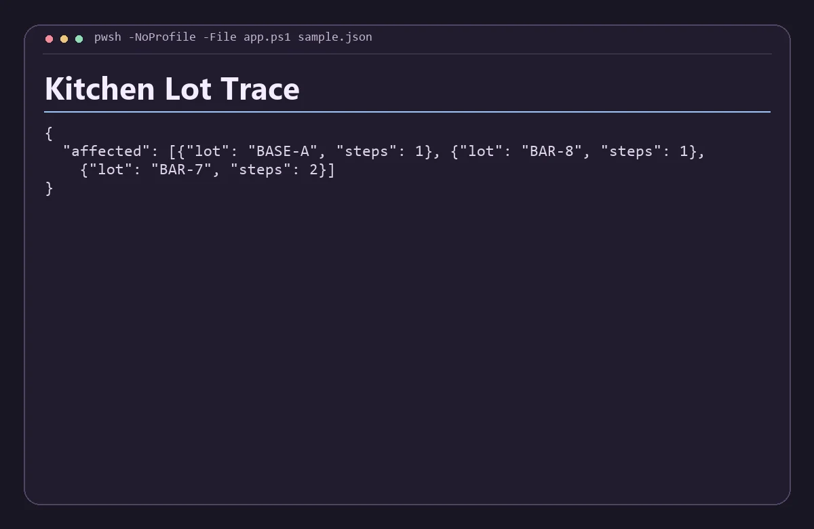

# Kitchen Lot Trace

Trace a kitchen ingredient lot through intermediate prep batches to finished goods, tracking the minimum number of handoffs.



## Run

Install PowerShell 7 or newer. Run these commands from the repository root.

```sh
pwsh -NoProfile -File app.ps1 sample.json
```

Replace `sample.json` with a JSON file following the same structure. The app prints a JSON report to standard output.

Each pair is [input lot, output lot]. Breadth-first traversal returns each downstream lot once, in discovery order. Duplicate paths and loops are handled. Lot identifiers are case-sensitive.

## Verify

Run `python check.py` with Python 3.11 or newer after the build step when applicable. The check verifies the bundled scenario and confirms that an invalid input returns an error.
